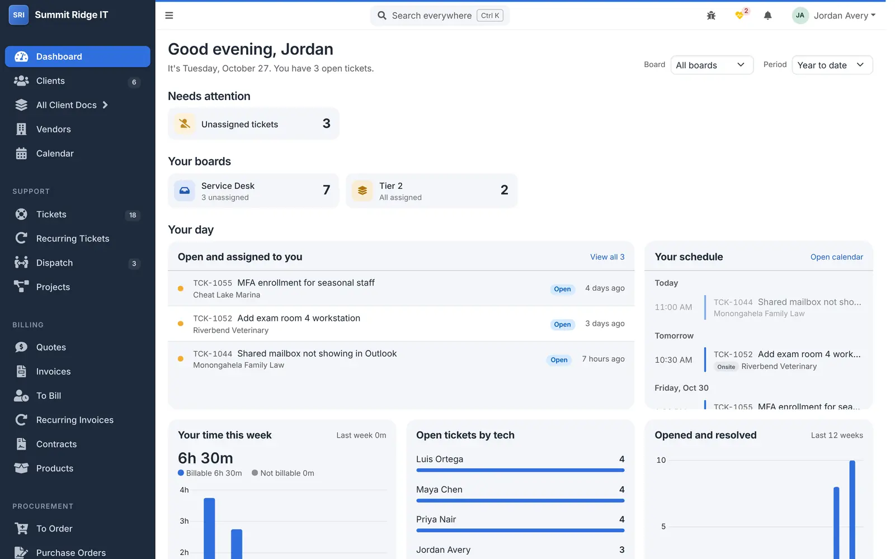
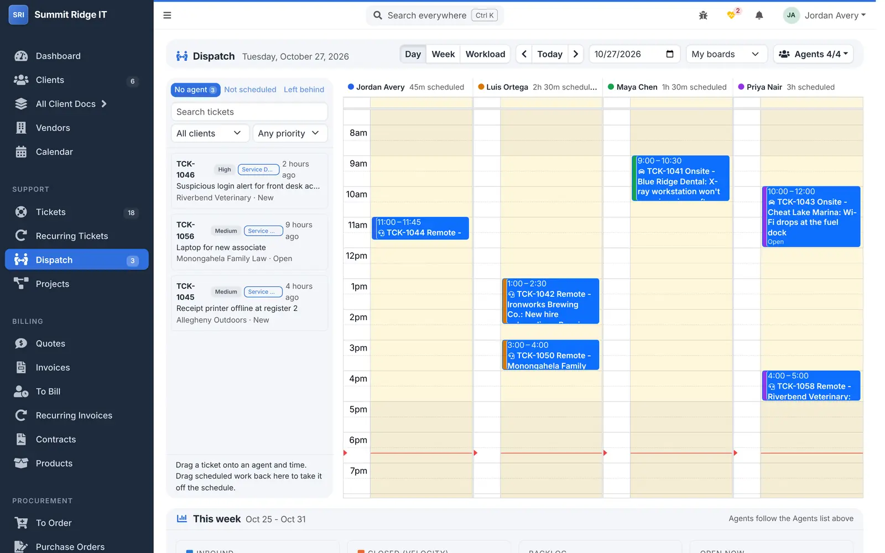
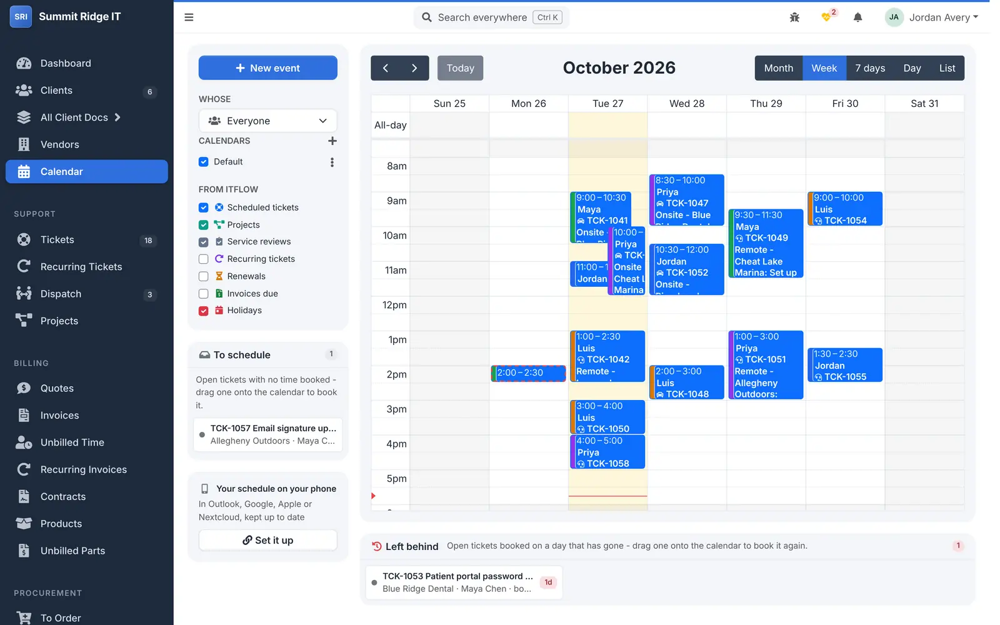
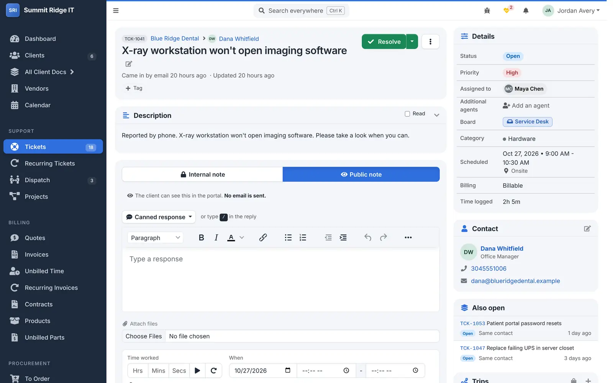
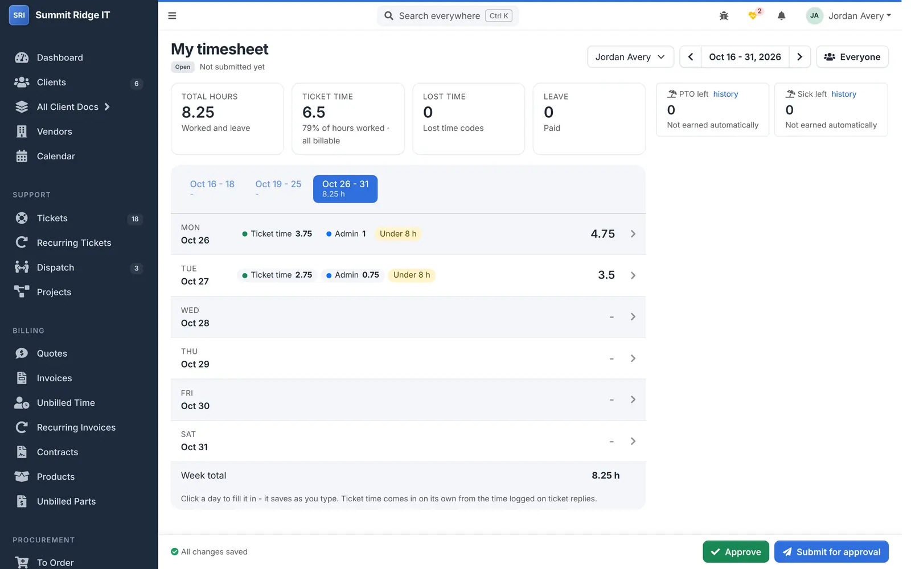
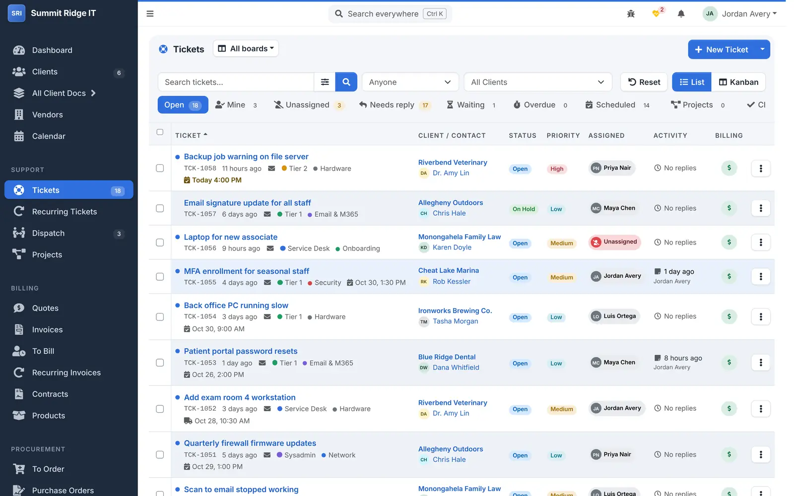

<div id="top"></div>

<div align="center">


[![Mountaineer IT build][build-shield]][changelog-url]
[![Last commit][commit-shield]][commit-url]
[![AGPL License][license-shield]][license-url]
[![Based on ITFlow][upstream-shield]][upstream-url]

<p>
  Mountaineer IT's build of <a href="https://github.com/itflow-org/itflow">ITFlow</a>, the open-source documentation, ticketing
  and accounting system for MSPs - with scheduling, dispatch, timesheets, procurement and integrations added.
</p>

<p>
  <a href="MIT_CHANGELOG.md"><strong>What's new</strong></a>
  &nbsp;·&nbsp;
  <a href="DEPLOYMENT.md">Install &amp; update</a>
  &nbsp;·&nbsp;
  <a href="MIT_FEATURES.md">Feature map</a>
  &nbsp;·&nbsp;
  <a href="MIT_API.md">API</a>
  &nbsp;·&nbsp;
  <a href="https://github.com/MountaineerIT/ITFLOW/issues">Report a bug</a>
  &nbsp;·&nbsp;
  <a href="#security">Security</a>
</p>

</div>

> [!NOTE]
> **This is not the official ITFlow.** It is an independent fork maintained by Mountaineer IT and is not made, supported or
> endorsed by the ITFlow project. For ITFlow itself - its docs, forum and support - go to [itflow.org](https://itflow.org).
> Please don't report problems with this build to the ITFlow team.

<picture>
  <source media="(prefers-color-scheme: dark)" srcset=".github/images/dashboard-dark.webp">
  
</picture>

<sub>Screenshots use made-up demo data. Light or dark follows your GitHub theme.</sub>

## About

ITFlow keeps an MSP's client documentation, tickets, quotes, invoices and expenses in one self-hosted system. This build
follows ITFlow's releases and adds what we need to run our own service desk. Everything ITFlow does still works the same way;
our additions sit beside it and can be switched off.

Each version is ITFlow's release plus our own number (for example **26.11.8.2** = ITFlow 26.11.8, our 2nd update on it). Admin >
Update shows both, with the release notes. This build is on ITFlow **26.11.8**.

## A look around

<table>
  <tr>
    <td width="50%" valign="top">
      
      <p><b>Dispatch</b> - a column per tech; drag tickets from the queue onto someone's day, or switch to the week or workload view.</p>
    </td>
    <td width="50%" valign="top">
      
      <p><b>Calendar</b> - everyone's bookings with start and end times, a colour per tech, and tickets still to schedule.</p>
    </td>
  </tr>
  <tr>
    <td width="50%" valign="top">
      
      <p><b>Tickets</b> - boards, extra agents, in-place pickers, and start / end times on every note.</p>
    </td>
    <td width="50%" valign="top">
      
      <p><b>Timesheets</b> - ticket time comes in on its own; codes, leave, approval and a payroll report.</p>
    </td>
  </tr>
</table>


<p align="center"><sub>The tickets list - service boards, remembered views and quick filters.</sub></p>

## What this build adds

**Scheduling and dispatch**
- Bookings with start and end times, a colour per tech, clash warnings and a "7 days" calendar view
- Extra techs on a ticket, each booked with the lead or at their own time
- Dispatch board - techs side by side for a day or a week, drag tickets from the queue, a workload view and weekly stats
- One Schedule window for a booking: the ticket's title, client, contact, assets, priority, status, board and SLA, who gets
  emailed, and the contact's other open tickets - merge a duplicate there and then
- Outlook calendar sync per tech, with Outlook busy times (all-day events too) shown in ITFlow
- Each tech's own time zone - the calendar, Dispatch and their booking emails show their clock, with the office's beside it
- New Ticket can set a status and book the work as it is made; drag over empty time on Dispatch to raise a ticket for that slot
- Recurring tickets booked at a set time when they are raised, and made days ahead (or before the 1st of the month for site visits)
- "Left behind" list of open tickets whose booking has passed; repeats like "the third Wednesday"

**Tickets**
- Service boards (Service Desk, Tier 1, Tier 2 ...) with routing rules, round-robin assignment, escalation and visibility by role
- Quick ticket - a + in the top bar for a call or a walk-up: client, contact, the issue, and the contact's open tickets
- Pick who gets each email reply (ITFlow's own @mentions tell agents about internal notes)
- Start and end times on notes, a running-timers list in the top bar, a customisable ticket page layout
- "Resolve - no response" with its own wording, and per-event notification switches
- Statuses that meet the SLA response target - moving a new ticket to "Assigned" (say) emails the client a "ticket assigned"
  message you write, and counts as the first response
- Project tickets kept off the service queue and SLA

**Time and payroll**
- Timesheets by pay period - ticket time filled in automatically, charge codes, approval, overtime and a payroll report
- California rules for non-exempt staff (meal and rest periods, premiums, daily overtime, signed attestation)
- Leave banks (PTO, sick) with accrual and carry-over; holidays; mileage and purchases paid back through payroll

**Quotes, procurement and billing**
- Quote pricing from cost (markup, margin or set price), a staff-only profit card, and images on lines and products
- Procurement - items to order, purchase orders with approval, tracking, receiving into stock, assets or ticket parts; PO lines
  can be put on a project at any time
- Several offices - each agent's trips start from their office, their ticket emails show its address and phone, and POs ship to any office
- Parts on tickets, billed from To Bill on the same invoice as the ticket's time, expenses and travel
- QuickBooks Online - invoice approval, batches sent to QuickBooks, payments brought back; each line goes to the income
  account of its category (hardware and labor on one invoice land in both), missing items are made, and terms go with every
  invoice - a client default (Net 30, Due on the 1st ...) that one invoice can change
- Usage billing in ITFlow's own "Quantity from" - a recurring line billed by a count from NinjaOne, Bitwarden, Ingram Micro or
  the API; Users / Devices lines can leave out placeholders ("Not tagged ...", or not tagged at all)
- Recurring invoices made days ahead of their date, due on that date or on the client's terms from it
- Client profitability - labor cost (each agent's cost per hour, with history), parts cost, profit, margin and break-even hours
  for flat monthly agreements, in ITFlow's own report

**Integrations**
- Microsoft 365 - creates its own app with a certificate; mail sent and read through Microsoft Graph
- NinjaOne asset sync with live device status, MSP Align client health, Customer Thermometer surveys
- AI helper - asks questions of past tickets and documents and drafts write-ups, with a hard wall around passwords and secrets

**API**
- The key in an `X-API-Key` or `Authorization: Bearer` header as well as ITFlow's ways, usage counts reported through
  `/api/v1/mit_usage/`, and API / service accounts - logins an API key acts as, kept out of every list of people and unable to
  sign in from a browser. Details in [MIT_API.md](MIT_API.md).

**Running it**
- One-line Debian installer, restore from Admin > Backup (large backups too, also through a proxy or firewall that limits
  upload size) and a development mode for test copies
- Cron health warnings and alert emails, consistency checks, a modern look (optional), bug and idea reports from the top bar (switched on in Admin > Debug)
- Side-menu sections that fold away, our settings on ITFlow's Settings overview and in Find a setting, and browsers that pick
  up changed scripts and styles after an update without a hard refresh

The full list, with where each piece lives in the code, is in [MIT_FEATURES.md](MIT_FEATURES.md). Release notes for every
version are in [MIT_CHANGELOG.md](MIT_CHANGELOG.md) (ITFlow's own are in [CHANGELOG.md](CHANGELOG.md)).

## API

ITFlow's REST API works here as it does on stock ITFlow. What this build adds or changes - other ways to send the key, the usage
counts endpoint, service accounts, and the few places where our features refuse a change - is in [MIT_API.md](MIT_API.md).

## Getting started

On a fresh Debian 12 or 13 server, as root:

```bash
curl -fsSL https://raw.githubusercontent.com/MountaineerIT/ITFLOW/MountaineerIT-ITFLOW/scripts/install.sh | bash
```

It installs Apache, PHP and MariaDB, sets up HTTPS (Let's Encrypt, self-signed, or none behind a proxy) and runs ITFlow's setup.
Options (`--help`: domain, beta branch, nightly updates, local AI ...) and how to move an existing ITFlow install over are in [DEPLOYMENT.md](DEPLOYMENT.md).

### Branches

| Branch | What it is |
|---|---|
| `MountaineerIT-ITFLOW` | Production - the default. Changes arrive only after they have run on beta. |
| `develop` | Beta / testing. All work lands here first. |
| `master` | An untouched copy of ITFlow's `master`, for comparison only - don't install it from here. |

Updates come through Admin > Update like stock ITFlow, from whichever branch the install follows.

### After installing

Our modules (Procurement, Timesheets, Dispatch) are on by default - switch off any you don't use under Admin > Settings >
Modules. Admin > Roles sets who can use each one. Each integration stays off until it is set up on its own page under Admin >
Integrations. The settings to check after a first install are listed in [DEPLOYMENT.md](DEPLOYMENT.md) ("Releasing to
production").

### Moving back to stock ITFlow

Our database changes only add tables and columns, so a backup from this build can be restored into stock ITFlow. What stops
working after such a move is listed in [DEPLOYMENT.md](DEPLOYMENT.md) ("Moving to stock ITFlow").

## Support

This build is maintained for Mountaineer IT's own use and is provided without support. Bugs and ideas can be opened as
[issues](https://github.com/MountaineerIT/ITFLOW/issues); signed-in users can also send them from the bug button in the top bar, once an admin turns it on in Admin > Debug.

## Security

Please **don't** report security problems in public issues. Use GitHub's private reporting on this repository
([Security > Report a vulnerability](https://github.com/MountaineerIT/ITFLOW/security/advisories/new)). If the problem is
also in stock ITFlow, report it to them as well, through [their security policy](https://github.com/itflow-org/itflow/security/policy).

No system is risk-free - use your judgement before storing highly confidential information in it.

## License and credits

ITFlow is © its authors - the [ITFlow project](https://itflow.org) and its
[contributors](https://github.com/itflow-org/itflow/graphs/contributors) - and is licensed under the
[GNU Affero General Public License v3.0](LICENSE) (AGPL-3.0; ITFlow moved to it from GPL-3.0 in 26.11.2). This build is a modified
version, distributed under the same license, "as is", WITHOUT WARRANTY OF ANY KIND. Our changes are listed in
[MIT_CHANGELOG.md](MIT_CHANGELOG.md) and in this repository's history.

**Source code:** the AGPL asks that anyone using a modified version over a network - our staff, and clients through the portal
or a guest link - can get its source. This build's complete source is this public repository,
<https://github.com/MountaineerIT/ITFLOW> (the `MountaineerIT-ITFLOW` branch is what runs in production).

Thank you to the ITFlow team and everyone who has contributed to it - this build only exists because of their work. If ITFlow
is useful to you, consider [supporting the project](https://itflow.org/hosting.php?want=sponsor).

<!-- MARKDOWN LINKS -->
[build-shield]: https://img.shields.io/badge/build-Mountaineer%20IT-2f6fde?style=for-the-badge
[changelog-url]: MIT_CHANGELOG.md
[commit-shield]: https://img.shields.io/github/last-commit/MountaineerIT/ITFLOW/MountaineerIT-ITFLOW?style=for-the-badge
[commit-url]: https://github.com/MountaineerIT/ITFLOW/commits/MountaineerIT-ITFLOW
[license-shield]: https://img.shields.io/badge/license-AGPL--3.0-orange?style=for-the-badge
[license-url]: LICENSE
[upstream-shield]: https://img.shields.io/badge/based%20on-ITFlow-blue?style=for-the-badge
[upstream-url]: https://github.com/itflow-org/itflow
